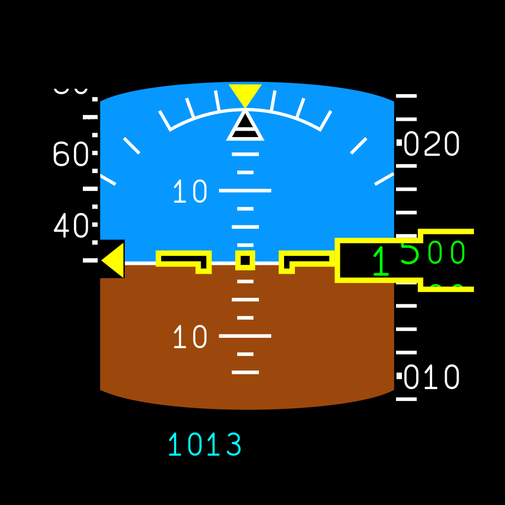
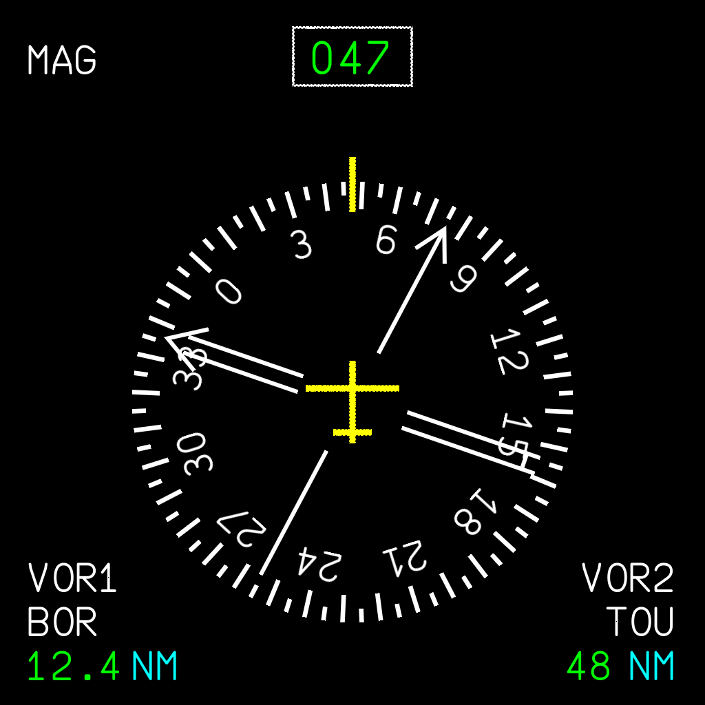

# A380X ISIS (standby displays)

The A380 has two ISIS (Integrated Standby Instrument System) units on the centre panel. At any
time one is the **Standby Flight Display (SFD)** and the other the **Standby Navigation Display
(SND)**: exactly one SFD is always shown, and two SFDs or two SNDs are impossible. FlyByWire
models only the SFD (`ISISlegacy`) and leaves `SCREEN_ISIS_2` disabled in `panel.cfg`. The
X-Plane port draws both units as native plugin cockpit devices:

* the SFD is a translation of FlyByWire `fbw-a380x/src/systems/instruments/src/ISISlegacy`
  (GPL-3.0, pinned revision `2baa2b35eadaf4c78e172ce41bbe6b40b4aeafb2`) and of FBW's cockpit
  behaviour templates `A32NX_Interior_ISIS.xml`;
* the SND is new (not in FBW): a minimal, honest standby navigation display (below).

| Part | File |
|---|---|
| Logic + display lists (XPLM/GL-free), SFD/SND roles | `native/avionics/a380x_isis.inc`, `a380x_isis.h` |
| X-Plane devices, commands, datarefs, OpenGL replay, key/knob feedback | `native/avionics/a380x_isis_adapter.inc`, `a380x_control_motion.h` |
| FBW `Ecam` font atlas (ISISFontTemporary.ttf) | `native/avionics/a380x_isis_font.h` ← `tools/build_isis_font.py` |
| Tests + software-raster previews | `native/avionics/test_isis.c` → `docs/isis-previews/*.png` |
| Cockpit geometry (screen quads, touch twins, buttons, knobs) | `tools/isis_cockpit_device.py`, `tools/avionics_panel_layout.py` (`ISIS_SCREEN_SURFACE`, `ISIS2_SCREEN_SURFACE`) |
| Button/knob animation in the panel OBJs | `tools/patch_controls_animations.py` (see `COCKPIT_CONTROLS.md`) |

| Unit | Device | Lighting channel | Commands / datarefs | Role at load |
|---|---|---|---|---|
| ISIS 1 (upper) | `a380x.xp12.isis.1` | 21 | `a380x/xp12/isis/…` | SFD |
| ISIS 2 (lower) | `a380x.xp12.isis.2` | 22 | `a380x/xp12/isis2/…` | SND |

## Rendering

FBW draws a 512×512 SVG into the 512×512 MSFS texture `SCREEN_ISIS_1`. The port draws the
same SVG coordinates at 2 texels per unit into a 1024×1024 device. The attitude group keeps
FBW's CSS `scale(1.1) translate(-30px,-30px)` (2.2 texels per unit). Colours, stroke widths,
clip viewports (the nested `<svg>` tapes and drums) and every path are taken from the
`.tsx`/`.scss` sources. Strokes use SVG miter joins and caps. Every edge gets a one-texel
alpha fringe, so the devices need no MSAA, scissor or stencil. Texts use the FBW font
rasterised at the exact drawn size (FBW px × 2 or × 2.2).

Each device redraws only when its display list changes, checked at no more than 30 Hz. A
typical SFD frame is about 9,500 vertices and takes about 0.15 ms to build and hash.

 

## SFD / SND roles

* **MODE** (on either unit) swaps the roles. The new SFD takes over the SFD settings (bugs,
  baro STD/QNH and unit, LS scales, metric altitude), so the standby flight data continue.
* If the SFD loses power (unit OFF) while the other unit is alive, the roles swap
  automatically: an SFD is always displayed.
* Each unit has its own power state machine (FBW self-test / ride-through), brightness and
  pop-up. Only the SFD writes the standby baro setting.

FBW maps the MODE button of its single ISIS to the BUGS page. With two units MODE is the
SFD/SND swap; the FBW BUGS page is reached from MENU → SET SPD BUG 1/2 / SET ALT BUG.

### SND content

Same 512-unit grid, colours, strokes and font as the FBW ISIS, Airbus ND conventions:

* rotating magnetic heading rose (ticks every 5°/10°, labels every 30° in tens) with a fixed
  yellow lubber line and aircraft symbol, and a green digital heading box;
* VOR1 single and VOR2 double white bearing pointers (only for a received non-localizer
  station), with VOR ident (white) or tuned frequency (cyan) and green DME distance;
* data with no reliable source are not invented: no heading → amber **HDG NOT AVAIL** (no
  rose, no pointers); no signal → no pointer, frequency only; no DME → no distance.

Inputs: `sim/flightmodel/position/mag_psi`, and for NAV1/NAV2
`sim/cockpit2/radios/indicators/navN_type`, `navN_relative_bearing_deg`, `navN_has_dme`,
`navN_dme_distance_nm`, `navN_nav_id` and `sim/cockpit2/radios/actuators/navN_frequency_hz`.
On the SND only MODE, + and − (brightness) and the pop-up act; LS, MENU and SET/SEL do nothing.

## Controls

| Control | Command (`isis/` or `isis2/`) | Behaviour |
|---|---|---|
| MODE pb | `…/mode` | Swap SFD / SND |
| LS pb | `…/ls` | SFD: FBW `LS`, toggles the LOC/GS scales (captain's NAV receiver) |
| + / − pb | `…/plus`, `…/minus` | Brightness ±0.025, repeating every 150 ms while held (FBW `AutoBrightness`, 0.03–0.99 around the X-Plane photo-cell level). On the BUGS / MENU pages they select the bug / item |
| MENU pb | `…/menu` | SFD: short press MENU page; hold 2 s ATT RST (FBW `RST`, 10 s `ATT nn s` flag) |
| SET/SEL knob | `…/set_up`, `…/set_down` | SFD: QNH ±1 hPa, or ±0.01 inHg (nothing in STD); bug value ±1 kt / ±100 ft (active bugs only); MENU items |
| SET/SEL push | `…/set_push` | SFD: QNH↔STD (QNH saved and restored, STD = 29.92); bug ON/OFF; select MENU item |
| Screen click | `…/popup` | Pop-up window |

Pages close after 15 s without input, as in FBW `index.tsx`.

**MENU page** (SFD; not in FBW, same typography as the FBW BUGS page): SET SPD BUG 1/2 and SET
ALT BUG open the BUGS page with that bug selected, DISPLAY METERS (FBW `ISIS_METRIC_ALTITUDE`),
SET BARO UNIT (FBW `ISIS_BARO_UNIT_INHG`), DISPLAY NAV and DISPLAY FIX show **NOT AVAIL**
(FBW has neither), EXIT.

**Mechanical feedback** (both units; `a380x_control_motion.h`): MODE, LS/D, +, − and MENU travel
1.0 mm into the panel with their legends (`…/<key>_pressed`, ~80 ms eased in/out, held while the
mouse/command is held, a click still shows a full press), the SET/SEL cap pushes 1.5 mm
(`…/set_sel_axial`), and the knob turns 10° clockwise per detent (`…/set_sel_rotation`, FBW
COUNT = 36, continuous with `ANIM_keyframe_loop 360`). Travel and axes are the authored FBW clips.

**Cockpit targets** are boxes over the authored meshes `PUSH_ISIS_n_MODE`, `LS_DIR`, `PLUS`,
`MINUS`, `MENU` (with legends), `KNOB_ISIS_n_SET_SEL` (click left/right half or mouse wheel to
turn) and the central 55 % of `PUSH_ISIS_n_SET_SEL` (push).

## Power, data and failures

* **Power** (each unit) follows FBW `ISISDisplayUnit`: `(IAS > 50 kt and DC HOT 1) or DC ESS`
  (DC ESS = `bus_volts[0] ≥ 18 V`, DC HOT = any `battery_voltage_actual_volts ≥ 18 V`).
* **States:** from OFF, power starts the 90 s self-test (yellow ATT/SPD/ALT flags, `INIT nn s`,
  baro), then ON; while ON, power loss keeps the display 10 s (STANDBY), then OFF. An aircraft
  loaded powered starts ON.
* **SFD inputs:** `airspeed_kts_stby`, `altitude_ft_stby`, `barometer_setting_in_hg_stby` (owned
  by the SFD), `theta`/`phi` (X-Plane has no standby attitude source), `machno`, `g_side`
  (FBW sideslip LagFilter), LOC/GS of the captain's NAV1, MDA from the native FMS.
* **Flags:** SPD when `rel_pitot_stby` or `rel_static_stby` fails, ALT when `rel_static_stby`
  fails, ATT when the writable `…/fail_att` is set (FBW self-test flag symbols).

Not implemented: LS course, DISPLAY NAV / FIX, SND map/route data (the SND shows only what has a
reliable X-Plane source).

## Datarefs

Per unit, under `a380x/xp12/isis/` (unit 1) and `a380x/xp12/isis2/` (unit 2), int and float:
`powered`, `state` (0 OFF, 1 SELFTEST, 2 ON, 3 STANDBY), `page` (0 PFD, 1 BUGS, 2 MENU),
`role` (0 SFD, 1 SND), `device_active` (created and bound; drives `ANIM_hide` of the quads),
`device_bound`, `draw_count`, `brightness` (float 0–1, int %), `ls_active`, `baro_std`,
`baro_unit_inhg`, `metric_altitude`, `init_seconds`, `fail_att` (**writable**),
`mode_pressed`, `ls_pressed`, `plus_pressed`, `minus_pressed`, `menu_pressed` (0–1),
`set_sel_axial` (0–1), `set_sel_rotation` (degrees clockwise, continuous).

## Geometry

The screens are the `SCREEN_ISIS_1` / `SCREEN_ISIS_2` primitives of `DYN_SCREEN` (vertices 0–3 /
4–7, MSFS `ASOBO_primitive` ranges), stored as `ISIS_SCREEN_SURFACE` / `ISIS2_SCREEN_SURFACE` in
the `PFD_SCREEN_SURFACES` convention (`docs/mfd-spec/09b-cockpit-geometry.md`).
`python3 tools/isis_cockpit_device.py --check <A380_COCKPIT_LOD00.gltf>` first reproduces
`SCREEN_DU_PFDL`, then re-measures both screens and all fourteen control bounds.

Device quads: visible 2 mm in front of the face in `a380x_mfd_screens.obj`, draw-disabled touch
twin 3 mm in `a380x_cockpit_controls.obj`, both hidden by `…/device_active` (the powered-off dark
faces show otherwise). The augments only append after `# A380X NATIVE ISIS 1 V1` /
`# A380X NATIVE ISIS 2 V1` and are idempotent.

## Build, install and test in the simulator

```sh
python3 native/avionics/build.py --sdk build/sdk/SDK --xpkit \
  --xpkit-assets output/A380X-XP12/plugins/A380XAvionics/mac_x64/xp-kit --output-dir /private/tmp/<fresh>
python3 tools/install_xp_kit_cockpit.py /private/tmp/<fresh> --check-only
python3 tools/install_xp_kit_cockpit.py /private/tmp/<fresh>      # X-Plane must not be running
python3 tools/patch_controls_animations.py --source <A380_COCKPIT_LOD00.gltf> \
  --directory output/A380X-XP12/objects/interior/cockpit-panels --backup <dir> --report <json>
python3 tools/validate_aircraft.py output/A380X-XP12
```

In the simulator:

1. Load cold and dark; switch on batteries and external power. Both ISIS show INIT for 90 s;
   then ISIS 1 shows the attitude display (SFD) and ISIS 2 the heading rose (SND).
2. Press MODE on either unit: the displays swap. Press it again to swap back.
3. Click a screen for its pop-up. Turn SET/SEL on the SFD for QNH, push for STD; the knob turns
   10° per click and the cap moves in while pushed.
4. Tune VOR stations on NAV1/NAV2: the SND shows the pointers, idents and DME.
5. Press LS on an ILS (SFD). MENU → SET SPD BUG 1 for the bugs. Hold MENU 2 s for ATT 10 s.
6. Fail the standby pitot/static for the SPD/ALT flags, or set `…/fail_att` to 1.
7. `Log.txt`: `A380X ISIS: devices a380x.xp12.isis.1 (SFD) / a380x.xp12.isis.2 (SND) and 18
   commands registered`.
